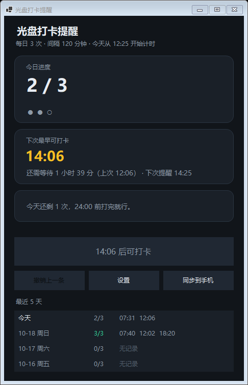
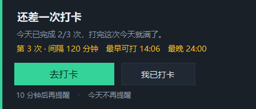
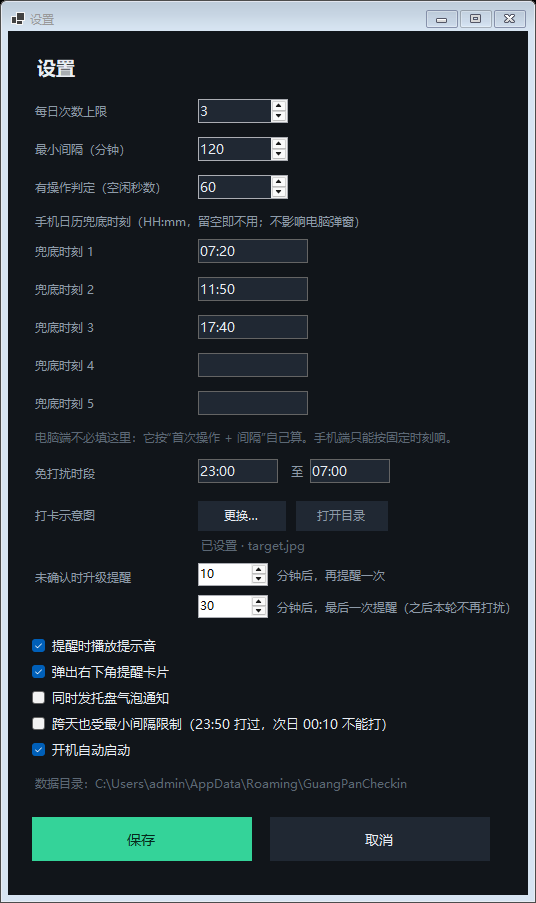

# 光盘打卡提醒（Clean Plate Campaign）

Windows 托盘小工具：按学校「每日最多 3 次、每次间隔至少 2 小时」的规则提醒你去微信小程序「光盘打卡」打卡，并记录每一次打卡时间。

**它不替你打卡，只负责不让你忘。**



---

## 一、下载

**当前版本：v1.1.0 ｜ Windows 10 / 11 ｜ 64 位 ｜ 48 MB ｜ 免安装、不依赖 .NET 运行时**

| 方式 | 适合谁 | 链接 |
|---|---|---|
| **① 发布页下载（推荐）** | 普通用户，点一下就能存 | [**→ 打开 Release 页面下载**](https://github.com/LXJ6668848/Clean-Plate-Campaign/releases/latest) ，在 `Assets` 里点 `光盘打卡提醒.exe` |
| ② 仓库内直接下载 | 想顺便看看源码 | 打开 [`release/光盘打卡提醒.exe`](release/光盘打卡提醒.exe) → 点右上角 **Download** 按钮 |
| ③ 命令行下载 | 习惯用终端 | 见下方 PowerShell 片段 |

```powershell
# 方式三：直接下载到「下载」文件夹
$url = "https://github.com/LXJ6668848/Clean-Plate-Campaign/releases/latest/download/光盘打卡提醒.exe"
Invoke-WebRequest -Uri $url -OutFile "$env:USERPROFILE\Downloads\光盘打卡提醒.exe"

# 下载后核对校验值（应与下方 v1.1.0 的 SHA256 完全一致）
Get-FileHash "$env:USERPROFILE\Downloads\光盘打卡提醒.exe" -Algorithm SHA256
```

**v1.1.0 校验值**（完整信息见 [`release/SHA256SUMS.txt`](release/SHA256SUMS.txt)）

```
size   : 48073597 bytes
sha256 : FC5BBE60AAE8837332EAEA7E5A7978DD4F35686A901E0963694E5A51E4AF9171
```

> 浏览器若提示「可能有害」或杀软报毒，是**单文件自包含 exe 未签名**导致的常见误报（`dotnet publish` 出来的包普遍如此），可用上面的 SHA256 自行核对文件是否被篡改。

---

## 二、安装

本程序**没有安装向导**，解压即用，不写注册表（除开机自启项），不写系统目录。

### 步骤

1. **建一个固定目录**，把 exe 放进去，例如：

   ```
   D:\Tools\光盘打卡提醒\光盘打卡提醒.exe
   ```

   > 不建议放桌面、下载文件夹或 `Program Files`：前者容易被误删，后者需要管理员权限，而程序要把数据写到 `%APPDATA%`。

2. **双击运行**。首次会弹出两个窗口：主面板 + 右下角状态提示；同时托盘区出现一个圆形图标。

3. **如果被 Windows 拦截**（蓝色的「Windows 已保护你的电脑」）：

   - 点「更多信息」→「仍要运行」；
   - 或在文件上右键 → 属性 → 勾选「解除锁定」→ 确定，再双击。

4. **把托盘图标拖出来固定**：点任务栏右下角的 `^`，找到圆形图标，用鼠标把它拖到任务栏上。图标颜色即状态：

   | 颜色 | 含义 |
   |---|---|
   | 灰蓝 | 还在等间隔，暂时不能打卡 |
   | 黄 | 现在可以打卡 |
   | 绿 | 今天 3 次已打满 |

5. **确认开机自启**（默认已开启）。托盘图标右键 → 勾选「开机自动启动」；不想要就取消勾选。注册表位置：
   `HKCU\Software\Microsoft\Windows\CurrentVersion\Run` → `GuangPanCheckin`。

6. **允许通知**：Windows 设置 → 系统 → 通知 → 找到「光盘打卡提醒」，确保通知开启、且未被「专注助手 / 勿扰」拦截，否则右下角卡片可能不显示。

### 卸载

托盘右键 →「退出」，删掉 exe 所在文件夹，再按需删除数据目录 `%APPDATA%\GuangPanCheckin`（删了就没了历史记录）。

---

## 三、快速上手

| 步骤 | 做什么 |
|---|---|
| 1 | 双击 exe，看到主面板 |
| 2 | 在小程序「光盘打卡」里完成一次打卡 |
| 3 | 回到面板点 **「我已打卡」**（或托盘菜单「立即打卡」） |
| 4 | 面板顶部会显示「还需等待 x 小时 y 分」——这是**硬约束**，提前点会被拦下并告诉你还差多久 |
| 5 | 到点后，右下角弹出提醒卡片 → 点 **「去打卡」** 看示意图，或点「我已打卡」直接记录 |

**提醒卡片的四个动作**

| 按钮 | 作用 |
|---|---|
| **去打卡**（绿色主按钮） | 弹出餐盘示意图窗口，提醒你去操作。**不算打卡**，不写记录，也不消耗本轮提醒次数 |
| **我已打卡** | 记录当前时间；间隔不够会被拦下 |
| 10 分钟后再提醒 | 把本轮推到 10 分钟后 |
| 今天不再提醒 | 今天彻底静音，明天 0 点自动恢复 |

---

## 四、提醒策略（关键设计）

**不按固定钟点，按「今天第一次碰电脑」起算**——固定 12:00 的闹钟，在你 12:40 才打卡时会完全失效。

| 环节 | 规则 |
|---|---|
| 计时起点 T0 | 每天第一次检测到键鼠输入的那一刻，写入 `runtime.json`，**每天只初始化一次**，重启程序不重算 |
| 节拍 | `T0 + 2 小时` = 第 1 轮到点；之后每弹一次，从**弹出那一刻**再数 2 小时 |
| 到点先看你在不在 | 读 `GetLastInputInfo`，最近 60 秒有输入才弹；人不在就压着，回来动一下鼠标立刻补弹 |
| 锁屏 / 免打扰 | 锁屏期间一律不弹；23:00–07:00（可配）静默 |
| 升级加催 | 未处理 → +10 分钟 → +30 分钟，本轮最多 3 响 |
| 跨天 | 0 点清空 T0 与轮次，等新一天第一次操作重新开始 |
| 休眠 | 到期时间是绝对时间，睡过去的照算；唤醒后要你动一下才补弹 |

派生值（已打卡次数、下次可打卡时间、剩余次数）**一律不落盘**，每次由「记录 + 设置」实时计算，避免状态错乱。

---

## 五、界面

| 提醒卡片 | 点「去打卡」后的示意图窗口 |
|---|---|
|  |  |

设置页可改：每日次数上限、最小间隔、免打扰时段、升级提醒间隔、提醒方式（卡片/气泡/声音）、跨天是否受限、有操作判定阈值、手机日历兜底时刻、打卡示意图。



---

## 六、常见问题

| 现象 | 处理 |
|---|---|
| 双击没反应 | 程序可能已在后台运行：去托盘 `^` 里找圆形图标双击。若确认没有，用 PowerShell 运行 `.\光盘打卡提醒.exe` 看是否报错 |
| 提醒卡片不出现 | ① 检查 Windows 通知与专注助手；② 看面板是否已打满 3 次或处于免打扰时段；③ 到点时人不在电脑前，回来动一下鼠标即会补弹 |
| 点「去打卡」没看到图片 | 设置页确认「打卡示意图」为「已设置」；文件被移动过就点「更换…」重新选一张 |
| 计时起点不对 | 面板顶部显示「今天从 HH:mm 开始计时」；想让今天重新起算，退出程序再启动（T0 保留），或在托盘菜单切换「今天不再提醒」 |
| 长时间看视频不弹 | 60 秒不碰键鼠会被判为离开，把设置里「有操作判定」调到 180–300 秒 |
| 换了电脑 | 拷贝 exe + 整个 `%APPDATA%\GuangPanCheckin` 目录，记录与设置都在里面 |
| 手机上也要提醒 | 托盘菜单「同步到手机日历…」生成 `.ics`，用微信文件传输助手发到手机导入。手机只负责按固定时刻响，电脑负责算和记录 |

20+ 条更细的排查与说明见 **[docs/使用指南.md](docs/使用指南.md)**。

---

## 七、仓库结构

```
.
├─ README.md
├─ docs/
│  ├─ 使用指南.md              完整中文使用指南（简介/安装/功能/步骤/FAQ/注意事项）
│  └─ images/                  界面截图
├─ src/GuangPanCheckin/        C# / .NET 9 WinForms 源码（17 个文件，可直接编译）
└─ release/
   ├─ 光盘打卡提醒.exe          win-x64 单文件，自包含
   └─ SHA256SUMS.txt           校验值与核对命令
```

## 八、技术要点

| 项 | 选择 |
|---|---|
| 语言 / 框架 | C# + .NET 9 WinForms |
| 发布形态 | 单文件自包含 exe（约 46 MB，免装运行时） |
| 存储 | JSON（`records.json` / `settings.json` / `runtime.json`），原子写入 + 每日备份 30 份 |
| 活跃判定 | `user32!GetLastInputInfo` 全局最后输入时间 |
| 锁屏 / 休眠 | `SystemEvents.SessionSwitch` + `PowerModeChanged` |
| 手机兜底 | 生成 RFC 5545 `.ics`（含 VALARM） |
| 窗口 | 无边框 + `WS_EX_TOOLWINDOW` + `ShowWithoutActivation`，不抢焦点、不进 Alt+Tab |

从源码构建（需 .NET 9 SDK）：

```powershell
cd src\GuangPanCheckin
dotnet publish -c Release -r win-x64 --self-contained true `
  -p:PublishSingleFile=true -p:IncludeNativeLibrariesForSelfExtract=true `
  -p:EnableCompressionInSingleFile=true -o ..\..\release
```

自检（开发期用，会写日志到 `%APPDATA%\GuangPanCheckin`）：

```powershell
.\release\光盘打卡提醒.exe --selftest   # 53 条边界逻辑用例
.\release\光盘打卡提醒.exe --uitest     # 23 条界面交互用例（含真实鼠标点击）
.\release\光盘打卡提醒.exe --idle       # 诊断：当前空闲秒数
.\release\光盘打卡提醒.exe --ics        # 重新导出手机日历
```

## 九、边界与说明

- 程序没运行 / 电脑关机时不会响，这部分交给手机日历兜底；
- 计时起点是「程序观测到的」第一次操作，程序未运行的那段时间观测不到；
- 数据全部保存在本机 `%APPDATA%\GuangPanCheckin\`，**不联网、无账号、不上传**。

### 关于「自动打卡」

小程序走 `api.clearplate.org.cn` 的私有接口，需要抓包拿 `x-token`，还要复用历史已上传的餐盘图路径。技术上能跑通，但本质是伪造就餐记录，且 token 会随登录态失效、接口随时改版。**本项目故意不做这件事。**

## 十、许可

未声明开源许可证，仅供个人学习与自用；如需转载或复用代码，请先联系作者。
